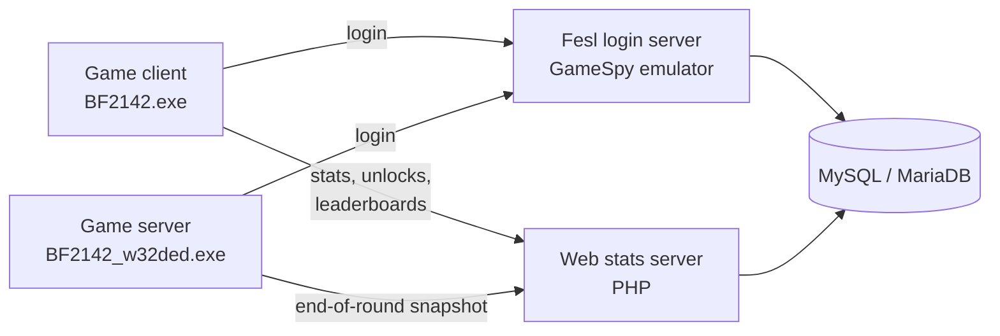

<div align="center">

# Battlefield 2142 Statistics Emulator Server

A self-hosted replacement for the shut-down EA / GameSpy backend of **Battlefield 2142**: login, ranked stats, leaderboards, awards and unlocks.

[](https://github.com/blue-tj01/bf2142stats_emu/actions/workflows/ci.yml)
[](LICENSE)


</div>

---

## Contents

- [How it works](#how-it-works)
- [Repository layout](#repository-layout)
- [Requirements](#requirements)
- [Quick start with Docker](#quick-start-with-docker)
- [Setup](#setup)
  - [1. Database](#1-database)
  - [2. Fesl login server](#2-fesl-login-server)
  - [3. Web (stats) server](#3-web-stats-server)
  - [4. Game server](#4-game-server)
  - [5. Game client](#5-game-client)
- [Security notes](#security-notes)
- [Troubleshooting](#troubleshooting)
- [Development](#development)
- [Credits and license](#credits-and-license)

## How it works



- **Fesl login server** (`fesl_login_server/`) handles accounts and logins in place of EA's FESL and GameSpy services.
- **Web stats server** (`web/`) answers the game's stats requests (`getplayerinfo.aspx`, `getleaderboard.aspx`, …) and receives round results from game servers (`bf2142statistics.php`).
- **Game server Python scripts** (`python/`) collect each player's stats during a round and send them to the web server when it ends.
- The game client and game server are pointed at your server through a patched executable or the Windows hosts file.

## Repository layout

| Path | What it is |
| --- | --- |
| `database/bf2142.sql` | Database schema to import into MySQL / MariaDB |
| `fesl_login_server/` | Login server (Windows) and its launch scripts |
| `web/` | PHP stats server; goes in your web server's document root |
| `python/` | Stats scripts for the dedicated game server |
| `exe_patch/` | `lpatch` and the patches for the dedicated server executable |
| `cracked_exe/` | Patched client executables for game versions 1.25 and 1.51 |
| `docker/`, `docker-compose.yml` | Docker setup for the web server and database |
| `tests/` | End-to-end smoke test used by CI |

## Requirements

| Component | Version |
| --- | --- |
| Web server | Apache with PHP **5.4 – 8.3** (tested on PHP 8.3). PHP 7+ needs the `mysqli` extension. [XAMPP](https://www.apachefriends.org/) is the easiest way to get Apache, PHP and MySQL together. |
| Database | MySQL 5.5+ / 8.x or MariaDB (tested on MariaDB 10.11) |
| Login server | Windows, [OpenSSL **1.0.2u** (Win32)](https://slproweb.com/products/Win32OpenSSL.html); newer OpenSSL versions are known not to work. Also needs `libmySQL.dll` from the [MySQL C Connector](https://downloads.mysql.com/archives/c-c/). |
| Game | Battlefield 2142 client and dedicated server, version **1.25** or **1.51** |

> [!NOTE]
> Throughout this guide, replace `your.external.ip` with your server's public IP address.

## Quick start with Docker

Docker runs the **web stats server and the database** for you, on any OS. The Fesl login server, game server and game client still need the setup steps below.

```sh
cp .env.example .env     # set passwords and AUTHORISED_SERVERS (your game servers' IPs)
docker compose up -d --build
```

This starts:

- **web**: Apache with PHP 8.3 serving `web/` on port `80`, already configured to use the database.
- **db**: MariaDB 10.11 with `database/bf2142.sql` loaded, published on `127.0.0.1:3306` so a Fesl login server on the same machine can use it.

Settings in `.env`:

| Variable | Purpose |
| --- | --- |
| `DB_NAME`, `DB_USER`, `DB_PASS` | Database and account used by the web server (and your Fesl login server) |
| `DB_ROOT_PASS` | MariaDB root password |
| `AUTHORISED_SERVERS` | Comma-separated game server IPs or `x.x.x.x/nn` subnets allowed to submit round stats |
| `WEB_PORT`, `DB_PORT` | Host ports for the web server and database |

> [!IMPORTANT]
> `AUTHORISED_SERVERS` is only applied when the database is first created. To add a server later:
> ```sh
> docker compose exec db mariadb -uroot -p bf2142 -e "INSERT INTO servers (ip, authorised, prefix, gport, bydnsname, dnshost) VALUES ('1.2.3.4', 1, 'BF2142', 0, 0, 0)"
> ```
> On Docker Desktop (Windows/macOS), requests can reach the container from Docker's internal gateway instead of the game server's real IP. If round stats are rejected, check `docker compose logs web` for the IP that was refused and authorise that.

Round logs are kept in the `web-logs` volume and the database in `db-data`; `docker compose down -v` deletes both.

## Setup

### 1. Database

1. Install MySQL or MariaDB.
2. Create a database and a user for it.
   On **MySQL 8**, create the user with the older password method, because the login server's `libmySQL.dll` can't use MySQL 8's default:
   ```sql
   CREATE USER 'bf2142'@'localhost' IDENTIFIED WITH mysql_native_password BY 'yourpassword';
   ```
3. Import the schema:
   ```sh
   mysql -u root -p yourdbname < database/bf2142.sql
   ```

> [!WARNING]
> Keep MySQL reachable from localhost only.

### 2. Fesl login server

1. Install **Win32 OpenSSL v1.0.2u**.
2. Copy `libmySQL.dll` (from your MySQL install or the MySQL C Connector) into `fesl_login_server/`.
3. Edit `fesl_login_server/_launch.bat` and set `-dbname`, `-dbuser` and `-dbpass`. Leave `-dbhost` as `127.0.0.1`.
4. Add this line to `C:\Windows\System32\drivers\etc\hosts.ics`:
   ```
   your.external.ip  stella.master.gamespy.com
   ```
5. Run `_launch.bat`.

> [!TIP]
> You can change the license agreement players see in `fesl_login_server/license.txt`. The game doesn't support line breaks, so it will be shown as a single line.

### 3. Web (stats) server

1. Copy the contents of `web/` into the **root** of your web server (for example `htdocs/` in XAMPP). The stats system doesn't work from a subfolder.
2. Edit `web/include/_ccconfig.php` and set `$db_host`, `$db_name`, `$db_user` and `$db_pass`.
3. In the `servers` table, add a row for each game server that may submit stats (its local and external IP) with `authorised` set to `1`. Stats from any other IP are rejected.
4. Make sure Apache allows `.htaccess` overrides (`AllowOverride All`) for the folder. `web/.htaccess` makes `.aspx` files run as PHP and blocks access to log files.
5. In `php.ini`, turn off error display so PHP messages can't end up in the game's responses:
   ```ini
   display_errors = Off
   ```

### 4. Game server

1. Install the Battlefield 2142 dedicated server files.
2. Copy the `python/` folder into the server's main folder, overwriting the existing files.
3. Patch `BF2142_w32ded.exe` with `exe_patch/lpatch.exe`, using `fesl_1.25.lpatch` for version 1.25 or `fesl.lpatch` for 1.51.
4. Add this line to `C:\Windows\System32\drivers\etc\hosts.ics` (the IP of your **web** server):
   ```
   your.external.ip  stella.prod.gamespy.com
   ```
5. Configure your gameplay settings and start `BF2142_w32ded.exe`.

### 5. Game client

1. Install Battlefield 2142.
2. Replace `BF2142.exe` with the one from `cracked_exe/` that matches your game version.
3. Point the game at your server:

<details>
<summary><b>Version 1.25</b>: edit the hosts file</summary>

Add these lines to `C:\Windows\System32\drivers\etc\hosts.ics`:

```
your.external.ip bf2142-pc.fesl.ea.com
your.external.ip gpcm.gamespy.com
your.external.ip stella.available.gamespy.com
your.external.ip eapusher.dise.se
your.external.ip stella.prod.gamespy.com
your.external.ip stella.ms5.gamespy.com
your.external.ip ea.com
your.external.ip gamespy.com
your.external.ip messaging.ea.com
your.external.ip fesl.ea.com
your.external.ip gpsp.gamespy.com
your.external.ip gamestats.gamespy.com
your.external.ip eapusher.dice.se
```

</details>

<details>
<summary><b>Version 1.51</b>: hex-edit the executable</summary>

The 1.51 executable has the server IP built in as `192.168.1.3`. Replace it with yours:

1. Reverse the order of your IP's four numbers, e.g. `33.44.55.66` → `66.55.44.33`.
2. Convert that to hex, e.g. `66.55.44.33` → `42372c21` (an [IP-to-hex converter](https://www.browserling.com/tools/ip-to-hex) helps).
3. In a hex editor, go to address `0045c980` and replace bytes 4–7 (`0301a8c0`) with your value.

</details>

## Security notes

- Only game servers listed as `authorised` in the `servers` table can submit round stats.
- `web/sample.php` is a debugging page that can create login tokens for any player. `.htaccess` limits it to localhost; delete it on a public server if you don't need it.
- The endpoints save each request to `.txt` files in the web root, and these include players' login tokens. `.htaccess` blocks access to them, so don't remove those rules.
- The token format is EA's original, and its key is public in `ea_support.php`. Tokens are a convenience check, not real authentication.

## Troubleshooting

| Problem | Fix |
| --- | --- |
| Login server won't start or can't make SSL connections | Use **Win32 OpenSSL 1.0.2u**; newer versions don't work. |
| Login server can't connect to MySQL 8 | Recreate the user with `mysql_native_password` (see [Database](#1-database)). |
| `libmySQL.dll` missing | Recent XAMPP versions don't include it; get it from the [MySQL C Connector archive](https://downloads.mysql.com/archives/c-c/). |
| Game shows no stats or garbled responses | Check `display_errors = Off`, that `web/` is at the web root, and that `.htaccess` is being applied. |
| Round stats are never saved | Make sure the game server's IP is in the `servers` table with `authorised = 1`, and look in `web/logs/`. |
| `ExpiredAuth` errors | The server's clock is wrong. Login tokens expire after about 12 minutes, so sync the clock (NTP). |

## Development

Every push and pull request runs [CI](.github/workflows/ci.yml):

- a syntax check of all PHP files on PHP 7.4 – 8.3;
- the end-to-end smoke test (`tests/smoke_test.py`) against MySQL 8.0 and MariaDB 10.11, and against the Docker Compose stack.

The smoke test uploads round snapshots like a game server, calls every game endpoint like a client, and checks the responses and the database. To run it locally against the Docker stack:

```sh
docker compose up -d --build
BASE_URL=http://127.0.0.1 \
DB_CMD="docker compose exec -T db mariadb -u<DB_USER> -p<DB_PASS> <DB_NAME>" \
python3 tests/smoke_test.py
```

It needs Python 3 and the PHP CLI on your machine (to create test login tokens). The test submits rounds from your machine, so `AUTHORISED_SERVERS` must have included it when the database was created (on Linux, `172.16.0.0/12` covers Docker's network). It adds two test players (IDs `10000101` and `10000102`), so don't run it against a live database.

## Credits and license

- `lpatch` by [Luigi Auriemma](http://aluigi.org).
- Not affiliated with or endorsed by Electronic Arts or DICE. You need your own copy of Battlefield 2142.

Released under the [GNU General Public License v2.0](LICENSE).
