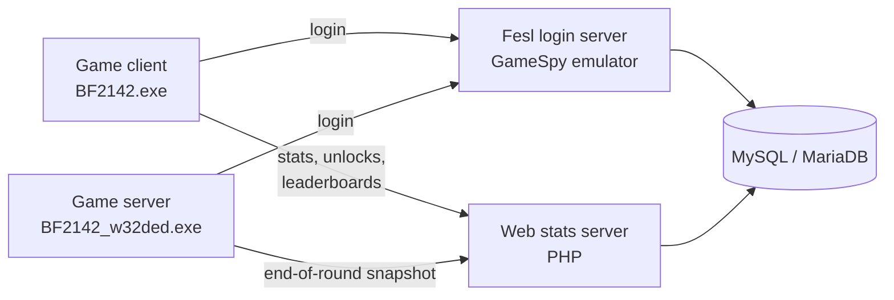

<div align="center">

# Battlefield 2142 Statistics Emulator Server

A self-hosted replacement for the shut-down EA / GameSpy backend of **Battlefield 2142**: login, ranked stats, leaderboards, awards and unlocks.

[](https://github.com/blue-tj01/bf2142stats_emu/actions/workflows/ci.yml)
[](LICENSE)


</div>

---

## Contents

- [How it works](#how-it-works)
- [Repository layout](#repository-layout)
- [Requirements](#requirements)
- [Quick start with Docker](#quick-start-with-docker)
- [Setup](#setup)
  - [1. Database](#1-database)
  - [2. Fesl login server](#2-fesl-login-server)
  - [3. Web (stats) server](#3-web-stats-server)
  - [4. Game server](#4-game-server)
  - [5. Game client](#5-game-client)
- [Security notes](#security-notes)
- [Troubleshooting](#troubleshooting)
- [Development](#development)
- [Credits and licensing](#credits-and-licensing)

## How it works



- **Fesl login server** (`fesl_login_server/`) handles accounts and logins in place of EA's FESL and GameSpy services.
- **Open FESL server** (`fesl_server/`) is an open-source replacement for the closed login server, still in development. It answers every FESL request of a normal login, with accounts and soldiers from the same database tables, but not GameSpy yet. See its [README](fesl_server/README.md).
- **Web stats server** (`web/`) answers the game's stats requests (`getplayerinfo.aspx`, `getleaderboard.aspx`, …) and receives round results from game servers (`bf2142statistics.php`).
- **Game server Python scripts** (`python/`) collect each player's stats during a round and send them to the web server when it ends.
- The game client and game server are pointed at your server through a patched executable or the Windows hosts file.

## Repository layout

| Path | What it is |
| --- | --- |
| `database/bf2142.sql` | Database schema to import into MySQL / MariaDB |
| `fesl_login_server/` | Login server (Windows) and its launch scripts |
| `fesl_server/` | Open-source FESL server in development, with its protocol captures, the stcppipe capture proxy and tests ([README](fesl_server/README.md)) |
| `web/` | PHP stats server; goes in your web server's document root |
| `python/` | Stats scripts for the dedicated game server |
| `exe_patch/` | `lpatch` and the patches for the dedicated server executable |
| `cracked_exe/` | Patched client executable for game version 1.51 |
| `docker/`, `docker-compose.yml` | Docker setup for the web server and database |
| `tests/` | End-to-end smoke test used by CI |

## Requirements

| Component | Version |
| --- | --- |
| Web server | Apache with PHP **5.4 – 8.3** (tested on PHP 8.3). PHP 7+ needs the `mysqli` extension. [XAMPP](https://www.apachefriends.org/) is the easiest way to get Apache, PHP and MySQL together. |
| Database | MySQL 5.5+ / 8.x or MariaDB (tested on MariaDB 10.11) |
| Login server | Windows, [OpenSSL **1.0.2u** (Win32)](https://slproweb.com/products/Win32OpenSSL.html); newer OpenSSL versions are known not to work. Also needs `libmySQL.dll` from the [MySQL C Connector](https://downloads.mysql.com/archives/c-c/). |
| Game | Battlefield 2142 client and Windows dedicated server, version **1.51**. The Linux dedicated server isn't supported: there's no FESL patch for it. |

> [!NOTE]
> Throughout this guide, replace `your.external.ip` with your server's public IP address.

## Quick start with Docker

Docker runs the **web stats server and the database** for you, on any OS. The Fesl login server, game server and game client still need the setup steps below.

```sh
cp .env.example .env     # set passwords and AUTHORISED_SERVERS (your game servers' IPs)
docker compose up -d --build
```

This starts:

- **web**: Apache with PHP 8.3 serving `web/` on port `80`, already configured to use the database.
- **db**: MariaDB 10.11 with `database/bf2142.sql` loaded, published on `127.0.0.1:3306` so a Fesl login server on the same machine can use it.

Settings in `.env`:

| Variable | Purpose |
| --- | --- |
| `DB_NAME`, `DB_USER`, `DB_PASS` | Database and account used by the web server (and your Fesl login server) |
| `DB_ROOT_PASS` | MariaDB root password |
| `AUTHORISED_SERVERS` | Comma-separated game server IPs or `x.x.x.x/nn` subnets allowed to submit round stats |
| `LOG_REQUESTS` | `1` to save every game request and round snapshot for debugging (see [Logs](#logs)) |
| `ADMIN_USER`, `ADMIN_PASS` | Login for the [web admin](#web-admin) at `/admin.php`; login is disabled while either is empty |
| `ADMIN_HOSTS` | Comma-separated IPs or subnets allowed to open the web admin. Your browser reaches the container through Docker's network, so on Linux use `172.16.0.0/12` to allow this machine |
| `WEB_PORT`, `DB_PORT` | Host ports for the web server and database |

> [!IMPORTANT]
> `AUTHORISED_SERVERS` is only applied when the database is first created. To add a server later:
> ```sh
> docker compose exec db mariadb -uroot -p bf2142 -e "INSERT INTO servers (ip, authorised, prefix) VALUES ('1.2.3.4', 1, 'BF2142')"
> ```
> On Docker Desktop (Windows/macOS), requests can reach the container from Docker's internal gateway instead of the game server's real IP. If round stats are rejected, check `docker compose logs web` for the IP that was refused and authorise that.

The database is kept in the `db-data` volume, and logs in `web-logs` and `web-debug-logs`; `docker compose down -v` deletes them.

## Setup

### 1. Database

1. Install MySQL or MariaDB.
2. Create a database and a user for it.
   On **MySQL 8**, create the user with the older password method, because the login server's `libmySQL.dll` can't use MySQL 8's default:
   ```sql
   CREATE USER 'bf2142'@'localhost' IDENTIFIED WITH mysql_native_password BY 'yourpassword';
   ```
3. Import the schema:
   ```sh
   mysql -u root -p yourdbname < database/bf2142.sql
   ```

> [!WARNING]
> Keep MySQL reachable from localhost only.

### 2. Fesl login server

> [!TIP]
> The open-source [`fesl_server/`](fesl_server/README.md#running-the-fesl-server) can already log players and their soldiers in from the same database (it takes the same `-dbhost`, `-dbname`, `-dbuser`, `-dbpass` options and runs on Linux), and saves the GameSpy pre-auth where `fesl_login_server.exe`'s GameSpy login reads it. It can create accounts and soldiers too, but soldiers it creates don't get a GameSpy player row yet, and it has no GameSpy service of its own, so keep using `fesl_login_server.exe` below for now.

1. Install **Win32 OpenSSL v1.0.2u**.
2. Copy `libmySQL.dll` (from your MySQL install or the MySQL C Connector) into `fesl_login_server/`.
3. Edit `fesl_login_server/_launch.bat` and set `-dbname`, `-dbuser` and `-dbpass`. Leave `-dbhost` as `127.0.0.1`.
4. Add this line to `C:\Windows\System32\drivers\etc\hosts.ics`:
   ```
   your.external.ip  stella.master.gamespy.com
   ```
5. Run `_launch.bat`.

> [!WARNING]
> Don't use `_launch_and_restoresrv.bat` (the `-restore_srv` option) on a public server. It emails players their password in plain text, and it builds the mail command from the e-mail address stored for the account, so a crafted address may be able to run commands on your machine.

> [!TIP]
> You can change the license agreement players see in `fesl_login_server/license.txt`. The game doesn't support line breaks, so it will be shown as a single line.

### 3. Web (stats) server

1. Copy the contents of `web/` into the **root** of your web server (for example `htdocs/` in XAMPP). The stats system doesn't work from a subfolder.
2. Copy `include/_ccconfig.example.php` to `include/_ccconfig.php`, then set `$db_host`, `$db_name`, `$db_user` and `$db_pass` in it. `_ccconfig.php` is ignored by git, so your settings never end up in a commit.
3. In the `servers` table, add a row for each game server that may submit stats (its local and external IP) with `authorised` set to `1`. Stats from any other IP are rejected.
4. Make sure Apache allows `.htaccess` overrides (`AllowOverride All`) for the folder. `web/.htaccess` makes `.aspx` files run as PHP and blocks access to log files.
5. In `php.ini`, turn off error display so PHP messages can't end up in the game's responses:
   ```ini
   display_errors = Off
   ```
6. Create a `logs/` folder **next to** the web root (not inside it) that the web server can write to. Errors go there, and so do request logs if you turn them on.

#### Logs

| Log | Where | Contents |
| --- | --- | --- |
| Errors | `../logs/_stats_errors.log` (`$debug_log`) | Database errors and rejected round uploads |
| Requests | `../logs/requests/` (`$log_dir`) | Every game request and round snapshot, one file per endpoint. **Off by default**; set `$log_requests = 1` in `_ccconfig.php` (or `LOG_REQUESTS=1` with Docker) while debugging. |

Paths are relative to the web root. Request logs contain players' login tokens, so keep them outside the web root and turn them off again when you're done.

#### Web admin

`admin.php` is a small admin panel: edit the config, see which game servers are authorised, import saved round logs and clear the stats.

1. Set `$admin_user` and `$admin_pass` in `_ccconfig.php` (or `ADMIN_USER` / `ADMIN_PASS` with Docker). Logging in is disabled while either is empty.
2. Open `http://your-server/admin.php` **from the server itself**. To open it from another machine, add that machine's IP or subnet to `$admin_hosts` (`ADMIN_HOSTS` with Docker); everyone else gets "Access denied".

Five failed logins from one address lock it out for 15 minutes. Several menu entries (backups, bans, merging players, …) are still marked "Under Construction".

#### Game servers on a dynamic IP

Round stats are only accepted from IPs in the `servers` table. For a game server whose IP changes, register it by DNS name and let `dnsch.php` keep its IP current:

```sql
-- Use the server's current IP; dnsch.php updates it when the name resolves elsewhere
INSERT INTO servers (ip, authorised, prefix, bydnsname, dnshost)
VALUES ('203.0.113.10', 1, 'BF2142', 1, 'mygameserver.example.com');
```

> [!WARNING]
> Never put `0.0.0.0` in the `servers` table: it matches every address, so anyone could submit stats.

Then run `php /path/to/web/dnsch.php` every few minutes from cron or Task Scheduler (with Docker: `docker compose exec web php dnsch.php`). Over HTTP it only answers requests from the server itself.

#### Upgrading an existing install

`web/include/_ccconfig.php` is no longer part of the repository. **Back it up before you `git pull`**, then put it back afterwards. Add these two lines to it if you want the request log setting:

```php
$log_requests = 0;
$log_dir = '../logs/requests/';
```

Old request dumps (`*.txt` files in the web root, such as `getplayerinfo.txt` and `sinthetixData.txt`) are no longer written and can be deleted.

To use the [web admin](#web-admin), add these lines too (older configs have them commented out with `#`):

```php
$admin_user = 'choose-a-username';
$admin_pass = 'choose-a-password';
$admin_hosts = array('localhost');
```

To register game servers by DNS name, the `servers.dnshost` column must hold text (older schemas made it a number):

```sql
ALTER TABLE servers MODIFY dnshost varchar(255) NOT NULL DEFAULT '';
```

### 4. Game server

1. Install the Battlefield 2142 dedicated server files.
2. Copy the `python/` folder into the server's main folder, overwriting the existing files.
3. Patch `BF2142_w32ded.exe` with `exe_patch/lpatch.exe`, using `fesl.lpatch`.
4. Add this line to `C:\Windows\System32\drivers\etc\hosts.ics` (the IP of your **web** server):
   ```
   your.external.ip  stella.prod.gamespy.com
   ```
5. Configure your gameplay settings and start `BF2142_w32ded.exe`.

### 5. Game client

1. Install Battlefield 2142.
2. Replace `BF2142.exe` with `cracked_exe/1.51/BF2142.exe`.
3. Point the game at your server. The executable has the server IP built in as `192.168.1.3`; replace it with yours:
   1. Reverse the order of your IP's four numbers, e.g. `33.44.55.66` → `66.55.44.33`.
   2. Convert that to hex, e.g. `66.55.44.33` → `42372c21` (an [IP-to-hex converter](https://www.browserling.com/tools/ip-to-hex) helps).
   3. In a hex editor, go to address `0045c980` and replace bytes 4–7 (`0301a8c0`) with your value.

## Security notes

- Only game servers listed as `authorised` in the `servers` table can submit round stats.
- Request logging is off by default. When it's on, the logs include players' login tokens, so keep `$log_dir` outside the web root. `.htaccess` also blocks `.txt`, `.log` and `.bak` files in the web root as a safety net.
- Your database password lives only in `web/include/_ccconfig.php`, which git ignores.
- `admin.php` only answers addresses in `$admin_hosts` (this machine by default), needs a login, and checks a per-session token on every form so other sites can't submit them for you.
- The token format is EA's original, and its key is public in `ea_support.php`. Tokens are a convenience check, not real authentication.
- The Fesl login server is a closed binary with no source in this repository, so it can't be audited or fixed here. It stores account passwords in plain text, and the queries embedded in it appear to insert the account name directly into SQL. Keep MySQL local-only, don't reuse real passwords on it, and leave `-restore_srv` off. Replacing it with an open-source implementation is the long-term fix, and that work has started in [`fesl_server/`](fesl_server/README.md).

## Troubleshooting

| Problem | Fix |
| --- | --- |
| Login server won't start or can't make SSL connections | Use **Win32 OpenSSL 1.0.2u**; newer versions don't work. |
| Login server can't connect to MySQL 8 | Recreate the user with `mysql_native_password` (see [Database](#1-database)). |
| `libmySQL.dll` missing | Recent XAMPP versions don't include it; get it from the [MySQL C Connector archive](https://downloads.mysql.com/archives/c-c/). |
| Game shows no stats or garbled responses | Check `display_errors = Off`, that `web/` is at the web root, and that `.htaccess` is being applied. |
| Round stats are never saved | Make sure the game server's IP is in the `servers` table with `authorised = 1`, and check `../logs/_stats_errors.log`. Turn on `$log_requests` to see exactly what the game server sends. |
| `ExpiredAuth` errors | The server's clock is wrong. Login tokens expire after about 12 minutes, so sync the clock (NTP). |

## Development

Every push and pull request runs [CI](.github/workflows/ci.yml):

- a syntax check of all PHP files on PHP 7.4 – 8.3;
- the end-to-end smoke test (`tests/smoke_test.py`) against MySQL 8.0 and MariaDB 10.11, and against the Docker Compose stack;
- the open FESL server's tests: capture replays, a server end-to-end test, and the same tests under AddressSanitizer/UBSan, plus a build of stcppipe (see [`fesl_server/`](fesl_server/README.md#getting-started)).

The smoke test uploads round snapshots like a game server, calls every game endpoint like a client, and checks the responses and the database. To run it locally against the Docker stack:

```sh
docker compose up -d --build
BASE_URL=http://127.0.0.1 \
DB_CMD="docker compose exec -T db mariadb -u<DB_USER> -p<DB_PASS> <DB_NAME>" \
python3 tests/smoke_test.py
```

It needs Python 3 and the PHP CLI on your machine (to create test login tokens). The test submits rounds from your machine, so `AUTHORISED_SERVERS` must have included it when the database was created (on Linux, `172.16.0.0/12` covers Docker's network). It adds two test players (IDs `10000101` and `10000102`), so don't run it against a live database.

## Credits and licensing

The project's own code is released under the [GNU General Public License, version 2](LICENSE). Copyright (C) 2014–2026 maiorBoltach and the project's contributors.

Not everything in this repository is the project's own work, and the GPL only covers the parts that are:

| Part | License |
| --- | --- |
| Web stats server (`web/`), database schema, Docker setup, CI and tests | GPL v2 (this project). Parts of the web code, such as the admin pages, come from the *BF2 Private Statistics* (BF2Statistics) project. |
| Game server scripts (`python/`) | Based on the scripts that ship with EA's Battlefield 2142 dedicated server and on BF2Statistics; the original authors' terms apply. |
| `cracked_exe/` | Modified Electronic Arts executables. **Not** covered by this project's license. |
| `fesl_login_server/fesl_login_server.exe` | Third-party binary with no source or license in this repository. |
| `fesl_server/` (open FESL server, tests, captures) | GPL v2 (this project). Imported from [2142master](https://github.com/blue-tj01/2142master) by Artyom Shcherbakov (Tema567) and contributors. |
| `fesl_server/src/stcppipe.c` and its headers | By [Luigi Auriemma](http://aluigi.org), GPL v2 or later. |
| `fesl_server/src/minini.*`, `minglue.h` | [minIni](https://www.compuphase.com/minini.htm) by CompuPhase, Apache 2.0 (not yet used by the server). |
| `fesl_login_server/blat/` | [Blat](https://www.blat.net/), public domain. |
| `exe_patch/` (`lpatch`) | By [Luigi Auriemma](http://aluigi.org). No license text is included in this repository. |

Not affiliated with or endorsed by Electronic Arts or DICE. You need your own copy of Battlefield 2142.
